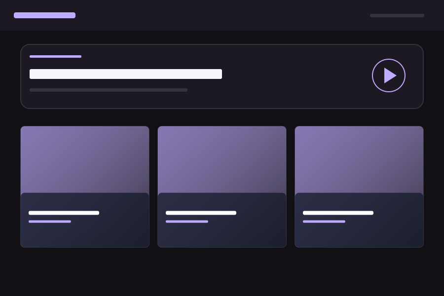

# MovieSites

[English](README.md) · [기여 안내](CONTRIBUTING.md) · [빌드 검사](https://github.com/JunSungKang/movie-sites/actions/workflows/quality.yml)

폴더에 저장된 영상을 탐색하고 재생하는 오픈소스 셀프 호스팅 영상 플랫폼입니다. Java 애플리케이션 하나로 실행하고, 원본은 외부 저장소에 보관하며, 컬렉션에 맞는 테마를 선택합니다.

## 미리 보기



Midnight Stream 테마의 배치 도식입니다. 실제 컬렉션 표지는 사용자의 외부 미디어에서 가져옵니다. 화면과 문서는 영어와 한국어를 지원합니다. 기본 화면은 영어이며 `MOVIESITES_UI_LOCALE=ko`로 한국어를 선택합니다.

## 주요 기능

- 열어 본 폴더의 바로 아래 항목을 탐색하며, 마운트된 로컬·네트워크 저장소를 사용합니다.
- 표준 HTML 영상 컨트롤로 재생하고, 필요한 경우 FFmpeg로 호환 재생본을 준비합니다.
- 폴더 표지, 영상별 JPEG 썸네일과 자동 생성 대체 이미지를 지원합니다.
- 짧은 영상부터 정렬하고 길이 구분선과 추천·직접 지정 주제 태그를 표시합니다.
- 브라우저에 대기열 하나를 저장하고 순서를 바꾸거나 연속 재생합니다.
- 환경변수로 기본 제공 테마 19개를 선택하고 카탈로그에 새 테마를 기여할 수 있습니다.
- 실행 가능한 JAR 또는 Docker 컨테이너 하나로 실행합니다. 화면은 정적 HTML·CSS·JavaScript입니다.
- 서버·브라우저에서 목록과 버전별 썸네일을 캐시하고 메모리 제한·명시적 새로고침을 지원합니다.
- 검색 노출용 소개 페이지를 제공하고 영상 목록은 검색 제외로 처리합니다.
- 신뢰할 수 있는 HTTPS에서 지원 브라우저의 PWA 앱으로 설치합니다. 영상은 기존처럼 서버에서 재생합니다.
- 목록 페이지와 백그라운드 처리에 제한을 둡니다. 데이터베이스·전체 트리 색인·재귀 파일 감시는 없습니다.

## 빠른 시작

### Docker

Ubuntu 26.04 이미지에는 Temurin 25·FFmpeg·ffprobe가 포함됩니다. 먼저 프로젝트 전용 Java 베이스를 빌드합니다. 호환 공통 이미지가 있으면 `JAVA_BUILD_IMAGE`·`JAVA_RUNTIME_IMAGE`로 지정할 수 있습니다. 아래는 POSIX 셸에서 비루트 호스트 사용자가 소유한 디렉토리를 사용하는 예입니다.

```bash
git clone https://github.com/JunSungKang/movie-sites.git
cd movie-sites
mkdir -p movie runtime
docker buildx bake -f docker-bake.hcl --load fallback-bases
MOVIESITES_IMAGE=moviesites:local docker buildx bake -f docker-bake.hcl --load moviesites
docker run --rm --init --name moviesites \
  --user "$(id -u):$(id -g)" \
  -p 127.0.0.1:8080:8080 \
  --mount "type=bind,source=$(pwd)/movie,target=/media,readonly" \
  --mount "type=bind,source=$(pwd)/runtime,target=/data" \
  --env-file .env.example \
  moviesites:local
```

`movie/`에 영상을 넣고 [localhost:8080](http://localhost:8080)을 엽니다. 원본은 이미지 외부에 유지됩니다. 기본 컨테이너 사용자, 백그라운드 실행, Windows 경로 및 NAS는 [Docker 안내](docs/ko/docker.md)를 참고하세요.

### 실행 가능한 JAR

JDK 25와 FFmpeg/ffprobe를 설치한 뒤 저장소의 Gradle Wrapper로 빌드합니다. Gradle을 따로 설치할 필요는 없습니다.

```bash
./gradlew clean build
MOVIESITES_MEDIA_ROOT="$PWD/movie" \
MOVIESITES_DATA_ROOT="$PWD/runtime" \
java -jar build/libs/moviesites.jar
```

플랫폼 조건은 [시작하기](docs/ko/getting-started.md)에 정리했습니다. Node.js와 Python은 추가 저장소 검사에 사용하며 서비스 실행에는 필요하지 않습니다.

이식 가능한 단일 서비스 Compose 구성은 [Docker 안내](docs/docker.md)를 참고하세요. `compose.yaml`의 `moviesites` 서비스를 사용하며 `compose.env.example`에서 호스트 경로·사용자·포트를 설정합니다.

## 설정

원본은 `MOVIESITES_MEDIA_ROOT`, 생성 데이터는 `MOVIESITES_DATA_ROOT`, 화면 테마는 `MOVIESITES_THEME`로 지정합니다. 기본 테마는 `20s-midnight-stream`입니다. 예를 들어 `MOVIESITES_THEME=20s-midnight-stream`으로 설정하고 재시작하면 해당 테마를 사용합니다.

`MOVIESITES_PUBLIC_URL=https://media.example.org`을 설정하면 `/about` 소개 페이지의 canonical·사이트맵 주소를 활성화합니다. 검색 노출 대상은 일반적인 사이트 소개이며 영상 목록은 기존 `/`에서 이용합니다. SEO·캐시 정책은 설정 안내에 정리했습니다.

모든 환경변수·기본값·허용 범위는 [설정 안내](docs/ko/configuration.md)에 있습니다. `.env.example`은 Docker 예시이며 JAR는 `.env` 파일을 자동으로 읽지 않습니다.

주제 추천은 기본으로 꺼져 있습니다(`MOVIESITES_TOPIC_PROFILE=none`). 교육 주제 추천이 필요하면 `kids-education`을 지정하세요. 영상별 직접 태그는 프로필과 무관하게 사용할 수 있으며 테마와 주제 프로필은 독립적입니다.

## 문서

| 목적 | 안내 |
|---|---|
| 설치하고 첫 영상 재생 | [시작하기](docs/ko/getting-started.md) |
| 환경변수 설정 | [설정](docs/ko/configuration.md) |
| 폴더·표지·대기열 관리 | [미디어 라이브러리](docs/ko/media-library.md) |
| 컨테이너 실행과 NAS 연결 | [Docker](docs/ko/docker.md) |
| 테마 선택과 기여 | [테마](docs/ko/themes.md) |
| 개발 환경과 검사 | [개발](docs/ko/development.md) |
| 동작 구조와 자원 제한 | [아키텍처](docs/ko/architecture.md) |
| 오류 원인과 복구 | [문제 해결](docs/ko/troubleshooting.md) |
| 검토·통합·배포 | [유지관리](docs/ko/maintainers.md) |
| 실제 검사 범위와 한계 | [검증 기록](docs/ko/verification.md) |

## 기여

코드·문서·번역·테스트·테마 기여를 환영합니다. [기여 안내](CONTRIBUTING.md)에 따라 fork, 작업 브랜치, 검사, PR 순서로 진행합니다. 기여자에게 개인 Codex 도구나 유지관리자 인증정보를 요구하지 않습니다. 현재 저장소의 유지관리자 전용 승인 제약은 기여 안내에 명시했습니다.

## 지원과 보안

재현 가능한 버그와 기능 제안은 [GitHub Issues](https://github.com/JunSungKang/movie-sites/issues)를 사용하세요. 민감한 신고는 [보안 정책](SECURITY.md), 참여 규칙은 [행동 강령](CODE_OF_CONDUCT.md)을 따릅니다.

현재 애플리케이션은 로그인 없는 읽기 전용 서비스입니다. 접속 가능한 방문자는 지정된 원본 루트의 지원 미디어를 탐색하고 재생할 수 있습니다. 외부 공개 전 배포 안내를 확인하세요. 원본 저장소에는 Java 보안 디렉토리 스트림 지원이 필요하며 네이티브 서버는 Linux/macOS를 대상으로 합니다. NAS·파일시스템과 실제 코덱 호환성은 환경별 검증이 필요합니다. [검증 한계](docs/ko/verification.md)를 참고하세요.

## 라이선스

[AGPL-3.0-only](LICENSE)를 적용합니다. 의존성과 컨테이너 구성요소는 [제3자 고지](THIRD_PARTY_NOTICES.md)를 참고하세요. 제공하는 미디어의 권리는 운영자가 확인해야 하며, 개인 영상과 생성 데이터는 소스에 포함하지 않습니다.
