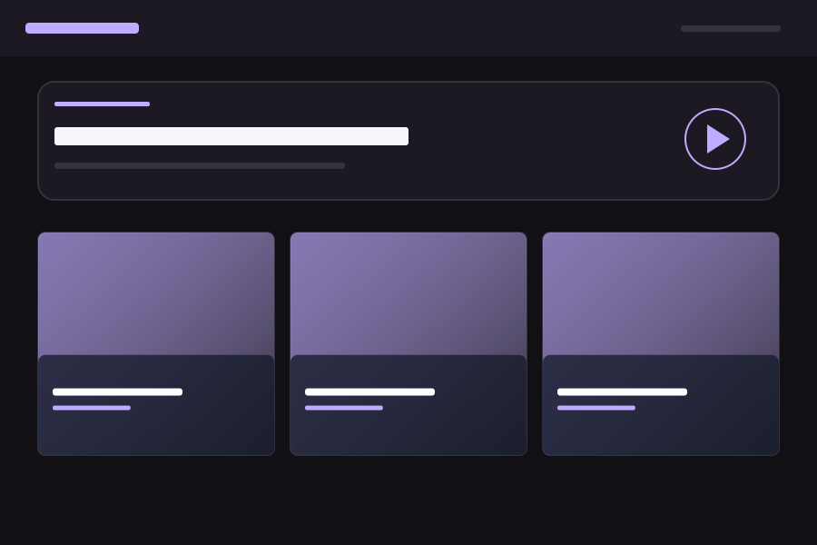

# MovieSites

> **Movie Kids operating branch.** The application source, Docker build and portable Compose definition stay identical to `main`. This branch adds the optional [Movie Kids preset](movie-kids.env.example): `child-toy`, Korean UI and education-topic suggestions. For a new portable deployment, select it explicitly with `MOVIESITES_ENV_FILE=movie-kids.env.example docker compose up -d --no-build` after building the image, or pass `--env-file movie-kids.env.example` to `docker run`. Existing deployments must keep their own service identity, ports and mounts; the preset contains no private host configuration. Common changes arrive through reviewed feature PRs, and `movie-kids` remains a permanent PR base.

[한국어](README.ko.md) · [Contributing](CONTRIBUTING.md) · [Build checks](https://github.com/JunSungKang/movie-sites/actions/workflows/quality.yml)

An open-source, self-hosted video platform that turns your folders into a browsable media library. Run one Java application, keep videos in external storage, and choose a presentation theme that fits your collection.

## Preview



Layout illustration of the Midnight Stream theme. Collection covers come from your own media. The interface and documentation support English and Korean. Set `MOVIESITES_UI_LOCALE=ko` for Korean; the default is English.

## Features

- Browse the folder you open, including nested collections on mounted local or network storage.
- Play videos with native HTML video controls and prepare compatible playback copies with FFmpeg when needed.
- Use folder covers and per-video JPEG thumbnails, with automatic video-thumbnail fallback.
- Browse videos shortest first with duration dividers and custom topic tags; optionally enable a filename-based topic profile.
- Keep one browser-local playback queue, reorder it, and play the queue in sequence.
- Select from 19 bundled themes through an environment variable; contribute additional presets through the theme catalog.
- Run a single executable JAR or Docker container. The frontend is static HTML, CSS and JavaScript.
- Cache directory snapshots and versioned thumbnails on the server and browser, with bounded memory and explicit refresh.
- Publish an optional search-friendly introduction while excluding the media catalog from search indexing.
- Install the library as a PWA on supported browsers using trusted HTTPS; videos continue streaming from your server.
- Use bounded directory pages and limited background processing. There is no database, full-tree index or recursive filesystem watcher.

## Quick start

### Docker

The Ubuntu 26.04 image includes Temurin 25, FFmpeg and ffprobe. Build the project-owned Java bases first, or supply `JAVA_BUILD_IMAGE` and `JAVA_RUNTIME_IMAGE` for compatible shared bases. These commands use a POSIX shell and directories owned by your non-root host user:

```bash
git clone https://github.com/JunSungKang/movie-sites.git
cd movie-sites
mkdir -p movie runtime
docker buildx bake -f docker-bake.hcl --load fallback-bases
MOVIESITES_IMAGE=moviesites:local docker buildx bake -f docker-bake.hcl --load moviesites
docker run --rm --init --name moviesites \
  --user "$(id -u):$(id -g)" \
  -p 127.0.0.1:8080:8080 \
  --mount "type=bind,source=$(pwd)/movie,target=/media,readonly" \
  --mount "type=bind,source=$(pwd)/runtime,target=/data" \
  --env-file .env.example \
  moviesites:local
```

Add your videos to `movie/` and open [localhost:8080](http://localhost:8080). The media directory stays outside the image. See the [Docker guide](docs/docker.md) for the default container user, background execution, Windows host paths and NAS mounts.

### Executable JAR

Install JDK 25, FFmpeg and ffprobe, then build with the committed Gradle Wrapper; a separate Gradle installation is not needed:

```bash
./gradlew clean build
MOVIESITES_MEDIA_ROOT="$PWD/movie" \
MOVIESITES_DATA_ROOT="$PWD/runtime" \
java -jar build/libs/moviesites.jar
```

See [Getting started](docs/getting-started.md) for prerequisites and platform requirements. Node.js and Python are used for additional repository checks, not for running the application.

For the portable single-service Compose deployment, read [Docker](docs/docker.md). `compose.yaml` runs the `moviesites` service; `compose.env.example` documents host paths, user and port settings.

## Configuration

Set `MOVIESITES_MEDIA_ROOT` for original media, `MOVIESITES_DATA_ROOT` for generated data, and `MOVIESITES_THEME` for presentation. The default theme is `20s-midnight-stream`; for example, use `MOVIESITES_THEME=20s-midnight-stream` and restart the application to choose a different preset.

Topic suggestions are disabled by default (`MOVIESITES_TOPIC_PROFILE=none`). Enable `kids-education` for conservative education-topic suggestions, or supply per-video tags regardless of profile. Theme and topic profile are independent.

Set `MOVIESITES_PUBLIC_URL=https://media.example.org` to enable canonical and sitemap URLs for `/about`. Only the generic introduction is intended for indexing; the library remains at `/`. See the SEO and cache policy in the configuration guide.

The [configuration reference](docs/configuration.md) is the source for defaults, limits and all environment variables. `.env.example` is a Docker example; the JAR does not automatically read `.env` files.

## Documentation

| Task | Guide |
|---|---|
| Install and play the first video | [Getting started](docs/getting-started.md) |
| Change environment settings | [Configuration](docs/configuration.md) |
| Organize folders, covers and the queue | [Media library](docs/media-library.md) |
| Run a container or connect a NAS | [Docker](docs/docker.md) |
| Choose or contribute a theme | [Themes](docs/themes.md) |
| Set up development and run tests | [Development](docs/development.md) |
| Understand the design and resource limits | [Architecture](docs/architecture.md) |
| Diagnose an error | [Troubleshooting](docs/troubleshooting.md) |
| Review and release changes | [Maintainers](docs/maintainers.md) |
| Read actual test coverage and limitations | [Verification](docs/verification.md) |

## Contributing

Contributions to code, documentation, translations, tests and themes are welcome. Start with [CONTRIBUTING.md](CONTRIBUTING.md), fork the repository, create a focused branch, run the checks and open a pull request. Contributor tooling does not require private maintainer credentials. Maintainers handle the repository-specific approval gate described in the contribution guide.

## Support and security

Use [GitHub Issues](https://github.com/JunSungKang/movie-sites/issues) for reproducible bugs and feature requests. Follow [SECURITY.md](SECURITY.md) for sensitive reports and the [Code of Conduct](CODE_OF_CONDUCT.md) when participating.

The current application is anonymous and read-only: visitors who can reach it can browse and play supported media beneath the configured root. Use the deployment guide before exposing a service. Native server storage must support Java secure directory streams; Linux/macOS are the current targets, and NAS/filesystem support must be checked in your environment. Supported extensions do not guarantee that every codec can be decoded. See the documented [verification limits](docs/verification.md).

## License

MovieSites is licensed under [AGPL-3.0-only](LICENSE). See [third-party notices](THIRD_PARTY_NOTICES.md) for dependencies and container components. You retain responsibility for the rights to media you serve; private videos and generated data are not distributed as project source.
